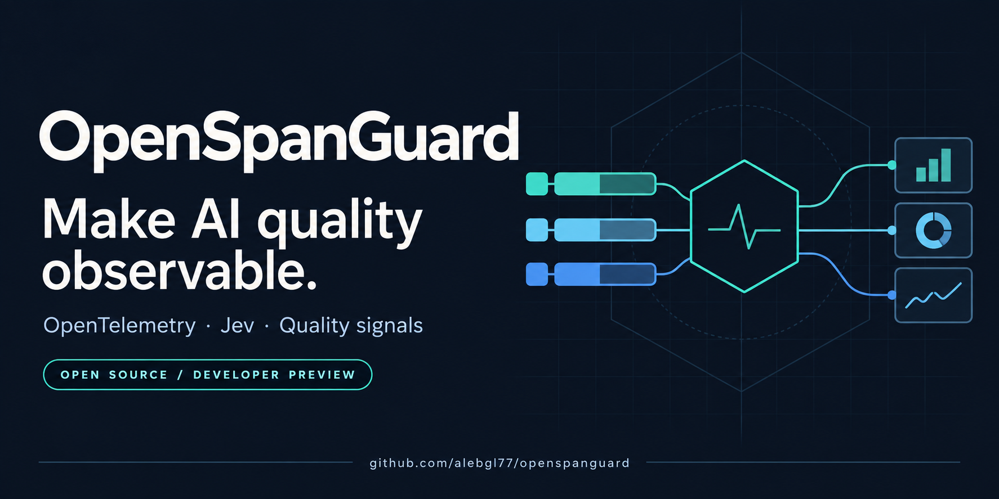
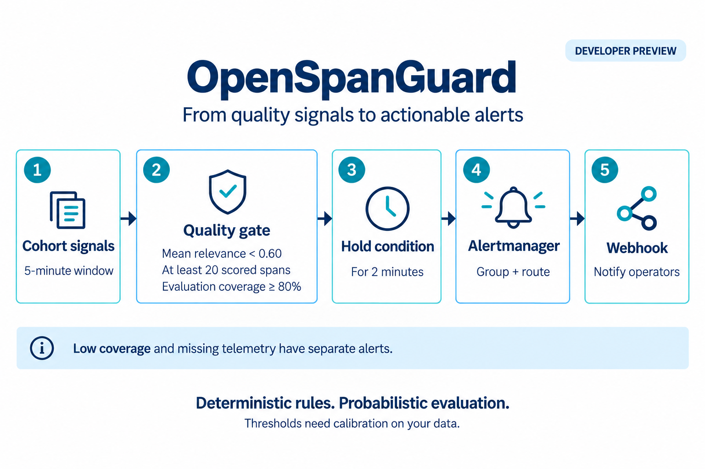
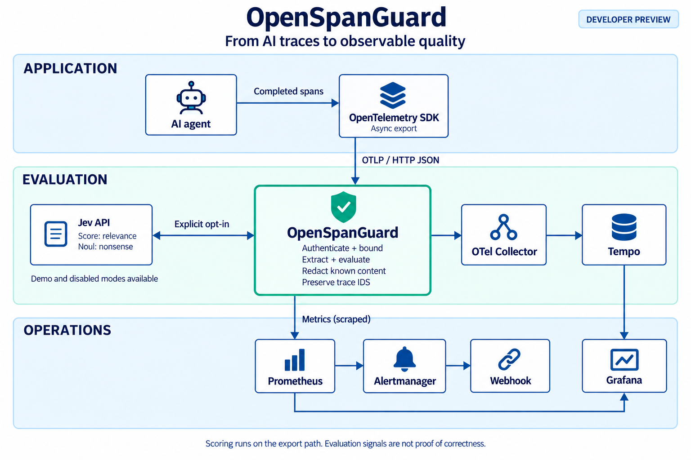
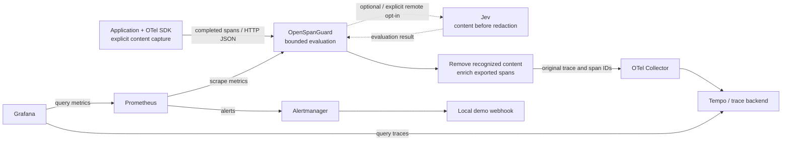

# OpenSpanGuard

**Make AI quality observable.**

[](https://github.com/alebgl77/openspanguard/actions/workflows/ci.yaml)
[](LICENSE)
[](https://github.com/alebgl77/openspanguard/releases)

OpenSpanGuard adds quality signals to your original AI traces. This **OTLP/HTTP JSON enrichment gateway** evaluates completed generation spans, preserves their trace/span IDs and timestamps, and exposes evaluation coverage alongside relevance in Prometheus and Grafana.

**Developer Preview · Apache-2.0 · Node.js 22 / 24 tested · Validate on a canary before production**

**[Try the demo ↓](#try-the-demo)** · [Read the integration guide](docs/integration.md) · [Website](https://alebgl77.github.io/openspanguard/) · [Français](README.fr.md)



[Why OpenSpanGuard](#why-openspanguard) · [Demo](#try-the-demo) · [Docker stack](#run-the-local-stack) · [Integration](#integrate-an-application) · [Signals](#interpret-the-signals) · [Architecture](#how-it-works) · [Docs and community](#docs-and-community)

## Why OpenSpanGuard

- **Keep trace context.** Inspect quality signals on the exported generation span, with its original identity and timing.
- **See evaluation gaps.** Missing content, disabled evaluation and timeouts remain explicit; successful scores never hide low coverage.
- **Use your observability stack.** Forward enriched traces to your collector and query bounded cohort metrics in Prometheus/Grafana.

Built for engineers operating instrumented AI applications. With a `BatchSpanProcessor`, evaluation runs on the telemetry export path after generation completes. Export and flush still incur evaluation and delivery latency. Start with the demo, then validate a permissioned canary against your own labels.

## Try the demo

Use Node.js 22 or 24 and npm:

```sh
git clone https://github.com/alebgl77/openspanguard.git
cd openspanguard
npm ci
npm run build
npm run demo
```

Once dependencies are installed, the demo runs with loopback services and requires no provider API key or Docker. It checks original IDs/timestamps, concurrent replay suppression, missing-content coverage, recognized-content redaction, a real OpenTelemetry JSON exporter, and streaming handling. The final JSON contains `"result": "pass"`. **All demo scores are synthetic.**

See the [recorded offline case study](docs/evidence/2026-10-22-offline-http-json.md) for the tested commit, commands, 81 passing tests, observed demo output and limits.

If PowerShell blocks `npm.ps1`, use `npm.cmd` for the same commands. See [troubleshooting](docs/troubleshooting.md) if setup fails.

## Run the local stack

Requires Docker Engine, Docker Compose and Node.js for the smoke scripts. From the cloned repository:

```sh
docker compose up --build -d --wait
node examples/stack-smoke.mjs
node examples/send-demo.mjs 180
```

Open [Grafana](http://127.0.0.1:3000/d/openspanguard/openspanguard). Three minutes of synthetic traffic populate relevance, confidence, nonsense, coverage, token and export-health panels. The smoke script checks delivery to Tempo and injects a synthetic alert to verify the local Alertmanager/webhook route.

Ports bind to loopback. Grafana is an anonymous read-only demo; Tempo storage is ephemeral. Stop with `docker compose down`; see [deployment](docs/deployment.md) for storage, cleanup and alert-rule validation.

## Integrate an application

Use `OTLPTraceExporter` from `@opentelemetry/exporter-trace-otlp-http` in your existing provider's `BatchSpanProcessor`, targeting `http://127.0.0.1:4318/v1/traces`. This preview accepts **HTTP/JSON**. The `-proto` exporter sends protobuf and receives HTTP 415.

The SDK helper is included **in this source repository**. The package is private; the quickstart builds locally. For an existing span, a JavaScript entry point in the cloned repository root can use:

```ts
import { annotateGeneration } from './dist/src/sdk.js';

span.setAttribute('gen_ai.operation.name', 'chat');
annotateGeneration(span, {
  prompt: 'What is a trace?',
  response: 'A trace records an operation.',
  cohort: 'canary',
});
span.end();
```

Capture content explicitly before ending the span. Supported `gen_ai.input.messages` and `gen_ai.output.messages` fields also work. Model names and token counts alone cannot supply evaluation content. With a running gateway, `npx tsx examples/sdk.ts` demonstrates batch export and streaming accumulation. See [integration](docs/integration.md) for auth, lifecycle handling and privacy boundaries.

### Enable live Jev evaluation

If the full demo stack is running, stop it with `docker compose down` first to free gateway port 4318. Then start only the local collector/Tempo with `docker compose up -d collector tempo`. Build with `npm run build`. In a POSIX shell, with `OSG_JEV_API_KEY` already supplied by your secret manager:

```sh
export OSG_EVALUATOR=jev
export OSG_ALLOW_REMOTE_CONTENT=true
export OSG_OTLP_ENDPOINT=http://127.0.0.1:4319/v1/traces
export OSG_JEV_API_KEY
npm start
```

[PowerShell setup](docs/integration.md#jev-in-powershell) is available. The process reads environment variables; copying `.env.example` does **not** load them. Jev sends captured content to the configured evaluation endpoint **before** recognized content is removed from onward traces, and provider charges may apply. Review [configuration](docs/configuration.md) and [measurement limits](docs/measurement.md) first.

## Interpret the signals

| Signal | What it tells you |
| --- | --- |
| Relevance | A five-level rubric result, normalized from 0–4 to 0–1 |
| Confidence | The evaluator's confidence in its relevance decision |
| Nonsense probability | Jev's `noul` result for this project's specific nonsense question |
| Coverage | Successful first-observation evaluations / first-observed generation spans, using the bounded local identity window |

These are evaluator signals, not proof of correctness. Nonsense probability is not a general hallucination probability. The sample relevance alert requires 20 evaluations in 5 minutes, at least 80% coverage, and mean relevance below 0.6 for 2 minutes. Calibrate those starting values against your workload before paging. Metrics record the first observed outcome for an identity; a successful retry does not revise that outcome while the metric identity window still suppresses it.



Read [measurement limits](docs/measurement.md) for held-out evaluation, false positives, sample bias and benchmark methodology.

## How it works



<details>
<summary>Technical diagram and editable sources</summary>



Editable diagrams: [architecture](docs/assets/architecture.drawio) · [quality loop](docs/assets/quality-loop.drawio).

</details>

Evaluation enriches exported OTLP; it does not modify the ended SDK span. `gen_ai.evaluation.result` is a span-event compatibility representation, not an emitted standard LogRecord. Recognized content is removed before forwarding; unrelated custom fields can retain sensitive data.

Cache and deduplication are bounded and process-local. Expiry, eviction, restart or another replica can cause re-evaluation. There is no disk queue or global exactly-once guarantee. See [architecture](docs/architecture.md) and the [production checklist](docs/production-checklist.md).

## Docs and community

| Need | Start here |
| --- | --- |
| Connect an application | [Integration](docs/integration.md) · [SDK example](examples/sdk.ts) |
| Operate the gateway | [Configuration](docs/configuration.md) · [Deployment](docs/deployment.md) |
| Understand evidence and limits | [Measurement](docs/measurement.md) · [FAQ](docs/faq.md) |
| Fix an integration | [Troubleshooting](docs/troubleshooting.md) · [Support](SUPPORT.md) |
| Discuss or contribute | [Discussions](https://github.com/alebgl77/openspanguard/discussions) · [Contributing](CONTRIBUTING.md) · [Roadmap](docs/roadmap.md) |
| Share the project | [Media kit](docs/media-kit.md) · [Launch kit](docs/launch-kit.md) |

To verify a change, run `npm run typecheck`, `npm test`, `npm run build` and `npm run demo`. `npm run benchmark -- 200` reports synthetic loopback measurements, not live Jev accuracy or production capacity.

Independent open-source project; no official OpenTelemetry, Grafana or Jev endorsement is implied. [Apache-2.0 license](LICENSE) · [Security](SECURITY.md) · [Code of conduct](CODE_OF_CONDUCT.md).

## Author

Built and maintained by **[Alexandre Beguel](https://github.com/alebgl77)**, Agentic AI Architect and external CAIO based in Paris. He works on production GenAI, LLMOps, LLM FinOps and evidence-first AI governance. [beguel.com](https://beguel.com/) · [LinkedIn](https://www.linkedin.com/in/beguel/) · [Profile in English, French and Spanish](https://alebgl77.github.io/)
