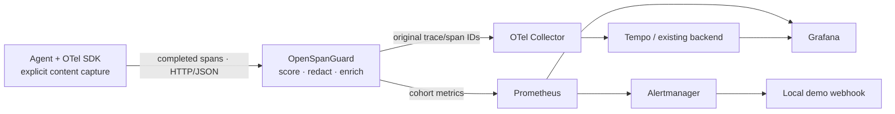

# OpenSpanGuard

**Quality signals on your original AI traces.**

OpenSpanGuard is an **OTLP/HTTP JSON enrichment gateway** for AI agents. It scores completed generation spans before forwarding them to your existing collector, preserving trace/span IDs and timestamps. With an asynchronous SDK span processor there is **no synchronous scoring on the generation path**. Trace export still incurs evaluation and delivery latency.

**Developer preview · Apache-2.0 · Node.js 22+ · Canary validation required**



## Try it offline

```sh
git clone https://github.com/alebgl77/openspanguard.git
cd openspanguard
npm ci
npm run demo
```

After dependencies are installed, `npm run demo` needs no API key, Docker, or internet. It starts a loopback collector and gateway and asserts original IDs/timestamps, concurrent replay suppression, missing-content coverage, content redaction, an actual OpenTelemetry JSON exporter, and streaming event/token handling. Final JSON reports `"result": "pass"`. **Every demo score is synthetic.**

## Run the local observability stack

Requires Docker Engine and Compose:

```sh
docker compose up --build -d --wait
node examples/stack-smoke.mjs
node examples/send-demo.mjs 180
```

Open [Grafana](http://127.0.0.1:3000/d/openspanguard/openspanguard) to inspect relevance, evaluator confidence, nonsense, coverage, token counts and export health. The traffic generator sends synthetic spans for 180 seconds to populate rate panels. The smoke script verifies trace delivery to Tempo and routes one synthetic alert through Alertmanager to the local webhook.

All published ports bind to loopback. Compose uses synthetic scoring, anonymous read-only Grafana and ephemeral Tempo storage. See [deployment and cleanup](docs/deployment.md).

## Instrument your application

Configure an exporter from `@opentelemetry/exporter-trace-otlp-http` for **HTTP/JSON**, targeting `http://127.0.0.1:4318/v1/traces`. The `-proto` package emits protobuf, which this preview rejects with HTTP 415. See the [official exporter guide](https://opentelemetry.io/docs/languages/js/exporters/).

Call the included helper before ending a span:

```ts
import { annotateGeneration } from './src/sdk.js';

span.setAttribute('gen_ai.operation.name', 'chat');
annotateGeneration(span, {
  prompt: 'What is a trace?',
  response: 'A trace records an operation.',
  cohort: 'canary',
});
span.end();
```

Content capture is explicit. Supported standard `gen_ai.input.messages` and `gen_ai.output.messages` fields also work. Missing content is skipped and lowers coverage. The gateway does not inspect encrypted application traffic. See the [SDK example](examples/sdk.ts) and [integration guide](docs/integration.md).

## Enable Jev

Start the local collector with `docker compose up -d collector tempo`. In a POSIX shell, with a real key already supplied by your secret manager:

```sh
npm run build
export OSG_EVALUATOR=jev
export OSG_ALLOW_REMOTE_CONTENT=true
export OSG_OTLP_ENDPOINT=http://127.0.0.1:4319/v1/traces
export OSG_JEV_API_KEY
npm start
```

`OSG_JEV_API_KEY` must already contain your key. Jev mode sends captured content to the configured evaluation endpoint and may incur provider charges. CI and the offline demo make no paid calls. [PowerShell instructions](docs/integration.md#jev-in-powershell) and [configuration](docs/configuration.md) include the details.

## Interpret the signals

| Signal | Meaning |
| --- | --- |
| Relevance | Five-level rubric result normalized from 0–4 to 0–1 |
| Confidence | Evaluator confidence in its relevance decision; 1 is not proof of truth |
| Nonsense probability | Jev's `noul` answer to this project's specific question; **not** a hallucination probability |
| Coverage | Successful unique evaluations / observed unique generation spans |

The relevance alert requires at least 20 evaluations in 5 minutes, at least 80% coverage, and mean relevance below 0.6 for 2 minutes. These are calibration starting values, not universal SLOs or zero-false-positive guarantees. See [measurement limits](docs/measurement.md).

## Limits and evidence

This independent project has no official OpenTelemetry affiliation. It enriches exported OTLP, not the already-ended SDK span. `gen_ai.evaluation.result` is a **span-event compatibility representation**, not an emitted standard OTel LogRecord.

Deduplication is bounded and process-local: TTL expiry, eviction, restart or another replica can cause re-evaluation. There is no disk queue or exactly-once guarantee. Review [architecture](docs/architecture.md) and the [production checklist](docs/production-checklist.md).

```sh
npm test
npm run typecheck
npm run build
npm run benchmark -- 200
```

The benchmark emits measured JSON for synthetic scoring and a loopback collector. It is not a Jev accuracy/latency benchmark or production capacity claim.

[Product brief](docs/PRD.md) · [Decisions](docs/adr/0001-enrichment-gateway.md) · [90-day roadmap](docs/roadmap.md) · [Launch plan](docs/launch-plan.md) · [Contributing](CONTRIBUTING.md) · [Security](SECURITY.md)
